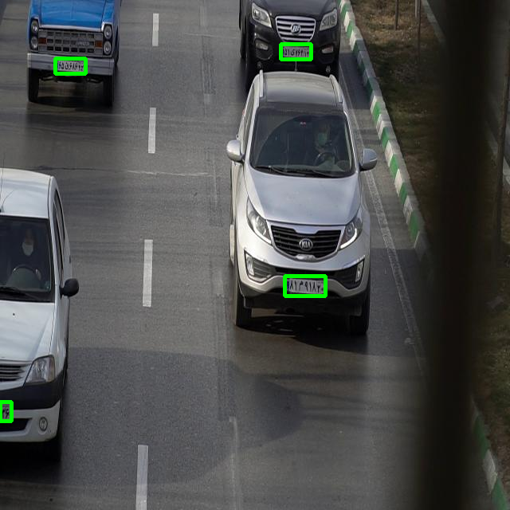
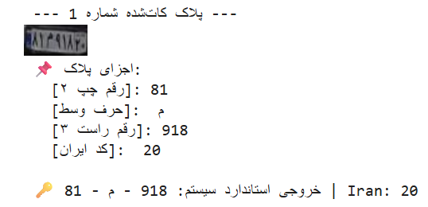
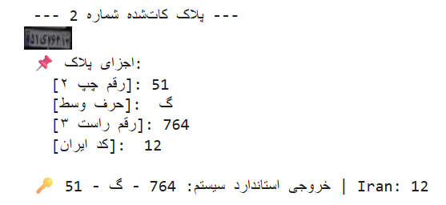
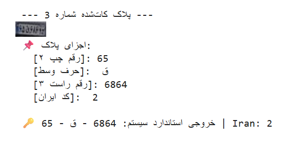

# Introduction
Hello everyone. This is Mohammad. I was surfing git hub projects about Persian license plate detectors and i realized that a few programmers write license detectors and most of other people just forked their repository and published that as their own name and that was not complete too for example in a high quality image of the plate number 12 was detected 17 by the program. So i decided to train whole network myself with a higher detection accuracy.
# Intended Uses 
This model is an accurate model in Persian license plate detection which can be used in traffic and police control center or building in which a camera can be installed and atheized cars can pass through. There are a lot of use cases that cannot be mentioned here. 
# Model Description
First plates are extracted by yolo-8 and cropped. I trained the model with @iran-license-plate-yolo downloaded from kaggle which contains picture of cards and their plates. The annotation contains plates location in the image from top corner to the bottom. At the end of training this stage we achieved mAP50 of 0.871 and mAP50-95 of 0.581.
The image below shows how plated are extracted from images:

For second network we trained by @iranian-license-plate downloaded from Kaggle. This dataset contains plates with Persian alphabet and their corresponding location on the image. For this we needed a bounding box instead of segmentation because of low need of computational resources and faster inference time.
For consistent learning we uploaded weights after each epoch to google drive to insure saving weights.
# Architecture

# Hyperparameters of Detector model
Total Epoches=25
Image Size=640
Batch Size=16
# Hyperparameters of OCR model
Total Epoches=25
Batch Size=32
image Size=320
# Computational Resources
All of out training is done on google colab T4 GPU.
# Limitations 
Images with low resolution, low quality or not sufficient lighting may affect models performance.

# Discussion 
If you have any suggestion i have opened discussion page you can send me your comments i will be glad to read them.
# Hugging Face 
You can upload your images at hugging face space and see output.

                   

# Links
https://www.kaggle.com/datasets/ashkan0201/iran-license-plate-yolo
https://www.kaggle.com/datasets/paryaparvan/iranian-license-plate
